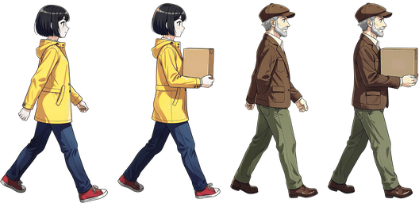
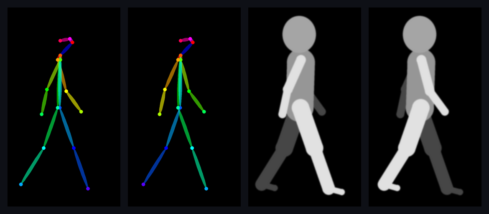
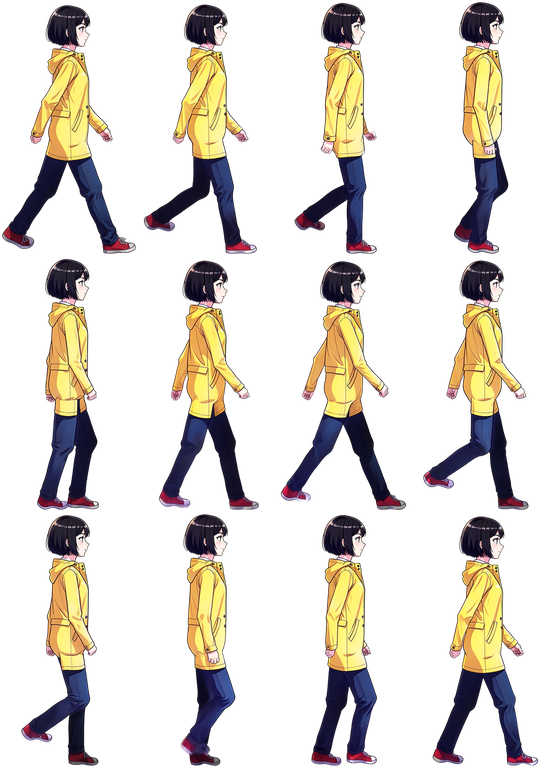
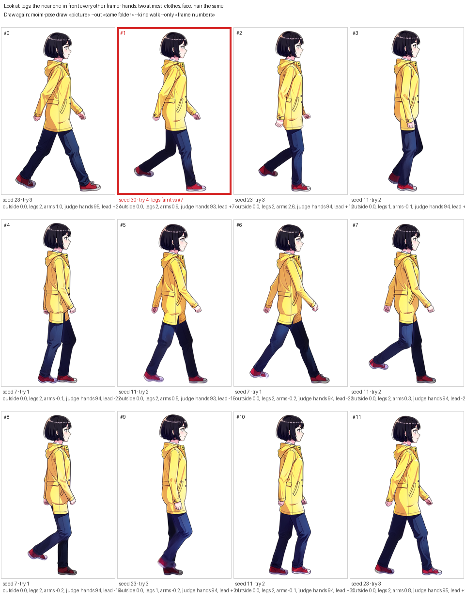

# marearts-moim-pose

<p align="center">
  
</p>

Walk-cycle sprites of one person from one picture. Give it a side view of a character; it draws the same
character walking (or carrying a box) in 12 frames that loop, checks every frame, locks height and head size
across the cycle, and writes a sprite sheet, GIFs and a small JSON a game can read.

It runs on an 8 GB GPU through ComfyUI: Wan 2.2 Fun Control 14B draws the cycle as one short video over depth
mannequins, FLUX.2 [klein] 4B makes each frame sharp. Every model it uses is Apache-2.0 or MIT.

Formerly **marearts-spritestride** (renamed in 0.2.0): the `spritestride` command and `import marearts_spritestride`
still work.

**ComfyUI workflows: [download on MareArts Open Lab](https://www.marearts.com/blogs/open-lab/marearts-spritestride-walk-cycle-sprites-from-one-picture?utm_source=github&utm_medium=readme&utm_campaign=spritestride)**

## Why frames drift, and what fixes it

| Problem | Why | What moim-pose does |
|---|---|---|
| The character changes from frame to frame (sleeves, hem, pockets, colours) | Each frame is drawn on its own, and each reads the clothes its own way | The cycle is drawn as **one video** over the mannequins, so each frame follows the one before. It is drawn **twice**: the second time from the video's own first frame made sharp (from a frame drawn alone the video put a round pouch on an older man's hip and every frame read it differently). Every frame is then made sharp from that one first frame, not from the standing picture |
| It walks "on the same foot" | In profile the two legs of a pose skeleton lie on one line, so the model cannot tell which is in front | A **depth mannequin** instead of a skeleton: far limbs dark, near limbs bright. Frames half a cycle apart must lead with **different legs** (the lighter leg in front in one, behind in the other); one drawn on the same foot is drawn again. In the finished frames the far leg is drawn darker, as sprite artists do |
| A third hand or foot appears, a hand goes missing, or the arms stand still while the legs walk | The model guesses where the far arm is, and a video loses hands that move fast | Each frame is **told where its arms are** (hanging, near arm forward, near arm back). Measured checks against the mannequin (an arm swung past it fails), and an optional **vision-model judge**: it draws a **box around each hand** and counts the boxes (asked to list the hands, it skipped one hanging under the coat between the two), says yes or no on a small crop **where the mannequin has the hand**, and counts the shoes. A hand the video lost is drawn again in the mannequin's hand crop only; a hand too many is drawn over in its box and the sleeve above it; the rest of the frame stays as it was |
| The coat ends at the hip at the back, the trousers' seat showing | In a mannequin with the thigh drawn over the body, the top of the thigh says "trousers" where a coat hangs | The mannequin's **seat covers the top of the near thigh** |
| The face turns to the viewer and becomes someone else | A plain oval head says nothing of where the face looks | The mannequin's head has a **nose**, the face in profile; with the judge, each head is compared with the picture's (DINOv2) and a frame of another person is drawn again |
| Height and head size wobble a few percent, and the feet slide | Drawn frames are never exactly the size of the pose | A **lock**: one master frame sets the head and the floor, the height follows the walk's own smooth wave, the legs are laid on the mannequin's legs |
| The sprite skates across the ground, or the arms move in jumps | A leg turning at an even rate moves the planted foot unevenly, and frames picked to make up for it come at uneven times | The standing leg is solved so the planted foot goes back the **same distance every frame** at even time steps (a body walks at a steady speed), and each arm swings on one smooth wave; that distance is written to the JSON |

<p align="center"></p>
<p align="center"><sub>Left: the pose skeleton at two steps half a cycle apart — almost the same shape. Right: the depth mannequin at the same steps — near limbs bright, far ones dark.</sub></p>

## Examples

Both characters were made from words only (`moim-pose person`), then walked and given a box, 12 frames a cycle,
each cycle drawn as a video. Every frame passed the checks; the judge found ten hands the video had lost and they
were drawn again in their place. One frame in each cycle still leads with a faint leg (marked in the review sheet).

| | made with |
|---|---|
| **Rin** | `--gait lively --look "a young woman with a short black bob, a yellow raincoat, dark blue jeans, red sneakers"` |
| **Otto** | `--gait older --look "an older man with a short grey beard and a brown flat cap, a brown corduroy jacket over a cream shirt, olive trousers, brown leather boots"` |

The loops at the top are the four cycles. Rin's walk as the sprite sheet a game reads:

<p align="center"></p>

## Install

```bash
pip install git+https://github.com/MareArts/marearts-moim-pose            # Python 3.10+
pip install "marearts-moim-pose[judge] @ git+https://github.com/MareArts/marearts-moim-pose"   # + the judge
```

You also need a running [ComfyUI](https://github.com/comfyanonymous/ComfyUI) (0.4x, its own nodes only) with these
models:

| Put in `ComfyUI/models/` | From | Licence |
|---|---|---|
| `diffusion_models/flux-2-klein-4b-fp8.safetensors` | [black-forest-labs/FLUX.2-klein-4b-fp8](https://huggingface.co/black-forest-labs/FLUX.2-klein-4b-fp8) | Apache-2.0 |
| `text_encoders/qwen_3_4b.safetensors` | [Comfy-Org/Flux-2-Klein-4B](https://huggingface.co/Comfy-Org/Flux-2-Klein-4B) `split_files/` | Apache-2.0 |
| `vae/flux2-vae.safetensors` | [Comfy-Org/Flux-2-Klein-4B](https://huggingface.co/Comfy-Org/Flux-2-Klein-4B) `split_files/` | Apache-2.0 |
| `loras/flux2_klein_4b_refcontrol_depth.safetensors` | [thedeoxen/refcontrol-FLUX.2-klein-4B-reference-depth-lora](https://huggingface.co/thedeoxen/refcontrol-FLUX.2-klein-4B-reference-depth-lora) | Apache-2.0 |
| `background_removal/birefnet.safetensors` | [Comfy-Org/BiRefNet](https://huggingface.co/Comfy-Org/BiRefNet) `background_removal/` | MIT |
| `diffusion_models/wan2.2_fun_control_high_noise_14B_fp8_scaled.safetensors` | [Comfy-Org/Wan_2.2_ComfyUI_Repackaged](https://huggingface.co/Comfy-Org/Wan_2.2_ComfyUI_Repackaged) `split_files/` (from [alibaba-pai/Wan2.2-Fun-A14B-Control](https://huggingface.co/alibaba-pai/Wan2.2-Fun-A14B-Control)) | Apache-2.0 |
| `diffusion_models/wan2.2_fun_control_low_noise_14B_fp8_scaled.safetensors` | the same | Apache-2.0 |
| `loras/wan2.2_i2v_lightx2v_4steps_lora_v1_high_noise.safetensors`, `..._low_noise.safetensors` | the same (from [lightx2v/Wan2.2-Lightning](https://huggingface.co/lightx2v/Wan2.2-Lightning)) | Apache-2.0 |
| `text_encoders/umt5_xxl_fp8_e4m3fn_scaled.safetensors`, `vae/wan_2.1_vae.safetensors` | the same | Apache-2.0 |

The Wan files are about 30 GB; ComfyUI moves each 14B model between the card and system memory (our PC has 64 GB).
`--engine frames` draws every frame on its own with the FLUX.2 files alone.

Judge (optional): [Qwen/Qwen3.5-9B](https://huggingface.co/Qwen/Qwen3.5-9B) (Apache-2.0) through transformers, or any
vision model behind an OpenAI-compatible server (llama.cpp, vLLM, Ollama). The head likeness uses
[facebook/dinov2-small](https://huggingface.co/facebook/dinov2-small) (Apache-2.0) on the CPU.

## Use

The reference picture: the whole character standing, side view, **facing right**, on a plain background. A picture
facing left is mirrored first: the judge says which way it faces, or without the judge the feet do (the shoes reach
past the ankles toward the toes); `--facing left|right` says it yourself. `moim-pose person` mirrors candidates
drawn facing left.

```bash
# no picture yet? candidates for a new character from words (pick one you like)
moim-pose person --out people/alice \
    --look "a woman with a red-orange bob and round glasses, a mustard knit sweater, rolled blue jeans, black sneakers"

# see the poses first (no GPU, no server)
moim-pose mannequin --out preview/ --gait lively

# draw a walk; describe the character in words too, it keeps clothes from drifting
moim-pose draw alice.png --out out/alice --gait neat \
    --look "a woman with a red-orange bob and round glasses, a mustard knit sweater, rolled blue jeans, black sneakers"

# carrying a box, with the judge on a local OpenAI-compatible server
moim-pose draw alice.png --out out/alice --kind carry --judge http://127.0.0.1:8080

# draw frames 2 and 6 again, then lock and sheet the whole cycle
moim-pose draw alice.png --out out/alice --only 2 6
moim-pose finish --out out/alice
```

| Option | Meaning |
|---|---|
| `--gait` | `neat relaxed lively upright calm graceful heavy older energetic loose`; or `--step --knee --arm --lean --elbow` |
| `--engine` | `video` (default: the cycle drawn as a video, then each frame made sharp) or `frames` (each frame drawn on its own) |
| `--video-model` | `14b` (default, 4 steps), `14b-full` (20 steps, about six times as long), `5b` (fewer files, keeps clothes worse) |
| `--frames` | frames a cycle (default 12; 8 makes a smaller sheet but the arms move in bigger jumps) |
| `--fps` | GIF speed (default 12: one cycle a second at 12 frames) |
| `--head` | head width / height of the character (0.19 for a big anime head with hair); the mannequin's head follows it |
| `--bust` | how far the chest stands out in the mannequin (0.13 for a fuller figure); the silhouette comes from the depth |
| `--change` | the one thing to draw differently from the picture |
| `--height` | sprite height in px (default 256, 0 = full 832 x 1216 frame) |
| `--far-shade` | how bright the far leg is against the near one (default 0.55; 1 = legs as drawn) |
| `--facing` | `auto` (default), `right`, or `left` (the picture is mirrored to face right) |
| `--alternate` | draw again a frame that leads with the same leg as the frame half a cycle away (off by default: the leg tones fix it, new seeds rarely do) |

Out, in `--out`:

| File | |
|---|---|
| `walk_sheet.png` | sprite sheet, 4 frames a row (4 x 3 at 12 frames), transparent |
| `walk_sheet.json` | frame size, fps, `stride_px_per_frame`: move the sprite that far each frame and the feet stay put |
| `walk_loop.gif` · `walk_strip.gif` | the loop in place · walking across a strip at its own stride (sliding feet show here) |
| `walk_0.png` … | full-size locked frames |
| `walk_review.png` | every frame with its number, seed and checks; failed ones in red — look at this first |
| `walk_report.json` | per frame: seed, every seed tried, measured checks, leg lead, judge answer, why it failed, seconds |
| `raw/` | the drawn frames, masks and mannequins before the lock |

On an RTX 2080 Super (8 GB) a cycle of 12 takes about 20 minutes: two videos of about two minutes each, then each
frame made sharp (half a minute to a minute a try, with retries).

## It is not 100 % — plan on a look

An image model draws every frame, and now and then it draws something wrong. Measured on an 8 GB card:

| | |
|---|---|
| Frames that passed the automatic checks at the first seed | 0.3.0, the 48 example frames drawn as videos: 73 % (35), the rest by the 6th try; ten of them a hand drawn again in its place. Before, drawn one by one: 84 % over 507 frames with the 0.1 checks, 69 % with the 0.2.0 checks |
| Walk cycles a person passed at the first look (one review of 12) | 4 of 12 — the others had a leg or a hand drawn oddly, a hat, beard or pocket that changed, a mouth open |
| What the checks catch | a third arm or leg, an arm swung past the mannequin, a carried box that turns or bobs; with the judge a third hand, a hand missing where the mannequin has it, a third shoe, a head that is another person; two steps on the same foot (by the legs' light, at the contact frames) |
| What they do not catch yet | the same foot at mid-stance (legs crossed), legs of one flat colour with no light on them, an odd hand pose, small changes in clothes or face |

<p align="center"></p>
<p align="center"><sub>Rin's walk review sheet, 12 frames. Frame 1 is boxed: its lead leg reads faint against frame 7, half a cycle away. The seed line shows the frames the judge sent back (try 2 to 5).</sub></p>

So the tool gives you **drafts that are checked**, not finished art. After every cycle open `walk_review.png`: every
frame with its number, seed and what was measured, frames that failed the checks boxed in red, and what to look at
written on top. Draw the frames you do not like again by number; they get seeds they have not had, and the report
keeps every frame's history:

```bash
moim-pose draw alice.png --out out/alice --only 3 5      # frames 3 and 5 again, then lock and sheets again
moim-pose draw alice.png --out out/alice --only 3 --use-seed 7   # a new try was worse: back to seed 7
```

A new seed is not always better. Each frame's report row keeps every seed it has tried, so you can go back.

Most fixes that stick are words, not retries: name in `--look` the piece that changed (a beanie "pulled down over the
whole top of the head", "bare legs of smooth skin"), and the next draw keeps it.

## The graphs in ComfyUI

**Get the ready-made ComfyUI workflows on the [moim-pose page of MareArts Open Lab](https://www.marearts.com/blogs/open-lab/marearts-spritestride-walk-cycle-sprites-from-one-picture?utm_source=github&utm_medium=readme&utm_campaign=spritestride)** (free sign-up)
— drag a `.json` into ComfyUI: a new character from words, one walk frame
(image 1 = depth mannequin, image 2 = the character), the cut-out, the cycle as a video (25 mannequins and frame 0),
and a video frame made sharp. `moim-pose workflows --out workflows/`
also writes them from your own server's node list.

## In Python

```python
from marearts_moim_pose import ma_gait, ma_frame_phases, ma_walk_points, ma_depth
from marearts_moim_pose.comfy import MaComfy
from marearts_moim_pose.pipeline import MaRequest, ma_draw_cycle

req = MaRequest(reference="alice.png", out="out/alice", gait=ma_gait("neat"), look="a woman with a red bob, ...")
ma_draw_cycle(req, MaComfy("http://127.0.0.1:8188"))
```

## Tests

```bash
pip install -e ".[test]" && pytest -q test
```

They run on CPU: the gait (even steps, legs swap, feet on the ground), the mannequin and checks, and the whole
draw -> check -> lock -> sheet path against a fake ComfyUI server.

## Licence

Apache-2.0. Made at [MareArts Open Lab](https://www.marearts.com/blogs/open-lab). If you make something with it,
we would like to see it.
